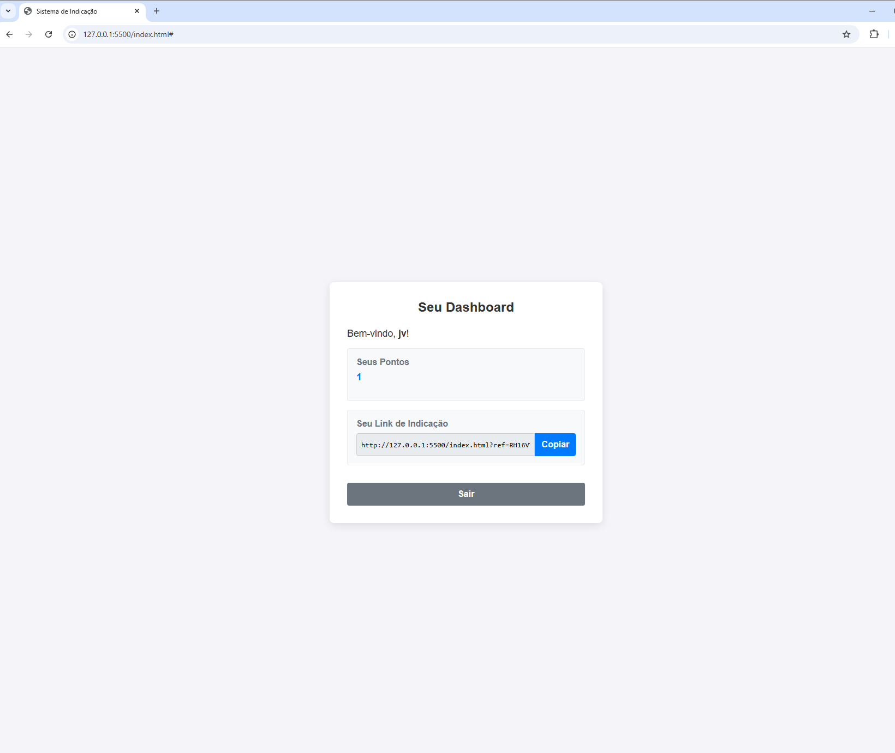

# 🌟 Sistema de Indicação (Referral System)


Uma aplicação **SPA (Single Page Application)** construída do zero, que implementa um sistema de cadastro de usuários e **pontuação por indicação**. Este projeto foi desenvolvido como parte de um **desafio técnico** para demonstrar habilidades em desenvolvimento full-stack com tecnologias modernas.

🔗 **Acesse online:** [sistema-de-indicacao-i388.onrender.com](https://sistema-de-indicacao-i388.onrender.com)

---

## 📸 Screenshot



---

## 🎯 Funcionalidades Principais

-   **Cadastro de Usuários:** Formulário para registro de novos usuários com validação de dados no front-end.
-   **Login Seguro:** Autenticação de usuários utilizando senhas criptografadas (`bcrypt`) e tokens de sessão (`JWT`).
-   **Dashboard de Perfil:** Exibe o nome do usuário, sua pontuação atual e seu link de indicação único.
-   **Sistema de Indicação:** Usuários ganham **+1 ponto** para cada novo cadastro realizado através de seu link.
-   **Copiar Link:** Botão para copiar o link de indicação para a área de transferência, facilitando o compartilhamento.

---

## 🛠️ Tecnologias Utilizadas

### **Back-end**


### **Front-end**


### **Testes**


---

## 🚀 Como rodar

Siga os passos abaixo para rodar o projeto em sua máquina.

### **Pré-requisitos**
-   [Node.js](https://nodejs.org/en/) (versão LTS)
-   [Git](https://git-scm.com/)

### **Passo a Passo**

1.  **Clone o repositório:**
    ```bash
    git clone https://github.com/Dimitri7/sistema-de-indicacao.git
    ```

2.  **Navegue até o diretório do projeto:**
    ```bash
    cd sistema-de-indicacao
    ```

3.  **Instale as dependências do back-end:**
    ```bash
    npm install
    ```

4.  **Inicie o servidor:**
    ```bash
    npm start
    ```

5.  **Abra no navegador:** `http://localhost:3000`

    O próprio Express entrega o front-end (pasta `public/`) e a API (`/api/users`), no mesmo endereço.

### **Variáveis de ambiente**

| Variável | Para que serve | Padrão local |
|---|---|---|
| `PORT` | Porta do servidor | `3000` |
| `JWT_SECRET` | Chave que assina os tokens de login. **Obrigatória em produção:** sem ela o servidor não sobe. | chave só de desenvolvimento |
| `DB_PATH` | Arquivo do banco SQLite | `db.sqlite` |

---

## 🧪 Testes

A API tem **testes automatizados de integração** escritos com [Jest](https://jestjs.io/) e [Supertest](https://github.com/ladjs/supertest). O Supertest faz requisições HTTP reais para o app Express, sem precisar abrir uma porta, e cada arquivo de teste usa um **banco SQLite em memória**, então o `db.sqlite` local nunca é alterado.

Para rodar:

```bash
npm test
```

**O que é testado (28 testes):**

| Arquivo | Cobre |
|---|---|
| `tests/cadastro.test.js` | Cadastro com código de indicação de 6 caracteres e 0 pontos · senha nunca devolvida na resposta · senha guardada com hash bcrypt · campos obrigatórios (400) · e-mail duplicado (409) |
| `tests/login.test.js` | Login devolve um JWT com o id do usuário e validade de 1 hora · senha errada (401) · e-mail inexistente recebe a mesma mensagem de senha errada, para não revelar quais e-mails existem · campos obrigatórios (400) |
| `tests/indicacao.test.js` | +1 ponto para quem indica · pontos acumulam e os indicados aparecem no dashboard · quem foi indicado não ganha ponto · código inexistente não pontua · cadastro que falha não dá ponto (transação desfeita) · dashboard exige token válido (401) |
| `tests/servidor.test.js` | Front-end e API servidos pelo Express · arquivos internos (`db.sqlite`, código-fonte, `package.json`) **não** ficam acessíveis pelo navegador · sem `JWT_SECRET` o servidor se recusa a subir em produção |

---

## ☁️ Deploy

O projeto está publicado no **[Render](https://render.com)** (plano gratuito): **https://sistema-de-indicacao-i388.onrender.com**

| Configuração | Valor |
|---|---|
| Build Command | `npm install` |
| Start Command | `npm start` |
| Variável de ambiente | `JWT_SECRET` (gerada pelo Render) |

> **Sobre o plano gratuito:** o servidor "dorme" após cerca de 15 minutos sem acessos, então o primeiro acesso pode levar até 1 minuto. O banco SQLite fica no disco temporário do Render, ou seja, as contas criadas são apagadas quando o serviço reinicia. Para uma demonstração isso é suficiente; em produção, o próximo passo seria trocar o SQLite por um banco gerenciado (ex.: PostgreSQL).

---

## 🤖 Colaboração com IA

Durante o desenvolvimento, utilizei um assistente de IA como mentor técnico, que me auxiliou em:

-   **Estruturação do Projeto:** Criação de uma arquitetura organizada em MVC (models, controllers, routes).
-   **Geração de Código + Explicação:** Implementação de funcionalidades acompanhada de explicações detalhadas sobre CORS, JWT, bcrypt, Fetch API, etc.
-   **Debugging Interativo:** Resolução de erros em tempo real (git, fetch, sintaxe, etc.).
-   **Aprendizado Prático:** Compreensão profunda do "porquê" de cada decisão técnica.

> A experiência foi equivalente a ter um programador sênior disponível 24/7, o que acelerou meu aprendizado e melhorou a qualidade do projeto.

---

## 👨‍💻 Autor

Feito com ❤️ por **Dimitri Albuquerque**

[](https://www.linkedin.com/in/dimitri-albuquerque-66b32b278/)
[](https://github.com/Dimitri7/)